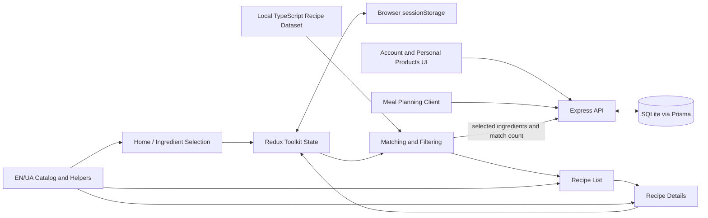

# Recipe Generator - Application Architecture

## Overview

The app keeps recipe discovery local-first while adding a small Express API for optional user accounts, personal products, and search history. Matching remains deterministic in the frontend; the API never stores or serves recipe records.

## Technology and code areas

| Area                        | Responsibility                                                                       | Location                                                              |
| --------------------------- | ------------------------------------------------------------------------------------ | --------------------------------------------------------------------- |
| Application shell           | Initialize React/Redux and render the active page                                    | `recipe-app-frontend/src/main.tsx`, `recipe-app-frontend/src/App.tsx` |
| Pages                       | Render ingredient selection, recipe results, and recipe details                      | `recipe-app-frontend/src/features/recipe-generator/`                  |
| Shared state                | Store selected ingredients, filters, active page, selected recipe id, and language   | `recipe-app-frontend/src/store/`                                      |
| Session persistence         | Hydrate and persist app state for the current browser session                        | `recipe-app-frontend/src/App.tsx` using `sessionStorage`              |
| Recipe data                 | Store typed recipe records and the canonical selectable ingredient catalog           | `recipe-app-frontend/src/data/recipes.ts`                             |
| Matching                    | Normalize names, calculate partial matches, apply filters, and rank results          | `recipe-app-frontend/src/lib/recipeMatching.ts`                       |
| Localization and categories | Provide EN/UA ingredient labels, category headings, UI text, and category lookup     | `recipe-app-frontend/src/lib/i18n.ts`                                 |
| Custom-product suggestions  | Provide bilingual product suggestions and their supported category ids               | `recipe-app-frontend/src/lib/productSuggestions.ts`                   |
| Shared types                | Define recipe, ingredient, filter, match, and category contracts                     | `recipe-app-frontend/src/types/recipe.ts`                             |
| Shared UI primitives        | Provide reusable cards, buttons, inputs, and labels                                  | `recipe-app-frontend/src/components/ui/`                              |
| Account and product UI      | Header popover for registration/sign in, profile, personal products, recent searches | `recipe-app-frontend/src/features/recipe-generator/AccountPanel.tsx`  |
| API client                  | Send credentialed requests and surface API errors                                    | `recipe-app-frontend/src/lib/api.ts`                                  |
| API server                  | Validate requests, authenticate sessions, enforce ownership, and persist user data   | `recipe-app-backend/src/`                                             |
| Persistence schema          | Define users, history, custom products, meal plans, and hashed-token sessions        | `recipe-app-backend/prisma/schema.prisma`                             |
| Meal plan API               | Store and retrieve user-owned recipe plans by date and meal type                     | `recipe-app-backend/src/`                                             |

## Ingredient selector

The Home page assembles selectable options from recipe ingredients, the canonical dataset catalog, seasonings, and the signed-in user's custom products. Catalog items use shared EN/UA labels; user-entered products display their saved name. Every option has exactly one of the eight ingredient categories.

| Category id  | English heading     | Ukrainian heading   |
| ------------ | ------------------- | ------------------- |
| `meat`       | Meat & Poultry      | М'ясо та птиця      |
| `grains`     | Grains & Cereals    | Крупи та зернові    |
| `vegetables` | Vegetables & Greens | Овочі та зелень     |
| `fruits`     | Fruits & Berries    | Фрукти та ягоди     |
| `dairy`      | Dairy & Cheese      | Молочні продукти    |
| `bakery`     | Bakery & Bread      | Хлібобулочні вироби |
| `spices`     | Spices & Seasonings | Спеції та приправи  |
| `pantry`     | Pantry & Oils       | Бакалія та соуси    |

The category union is `IngredientCategory`; category headings and canonical name-to-category assignments are maintained alongside the bilingual catalog in `recipe-app-frontend/src/lib/i18n.ts`. The custom-product suggestion dictionary includes English and Ukrainian common ingredients across produce, meat and seafood, dairy, grains, bakery, seasonings, and pantry items. Suggestions map to the existing eight category ids, including the dedicated `fruits` category, which the API validates. The Account Panel filters both localized names, displays the active-language label, and preserves free-text product entry.

## Data flow

1. The user selects catalog or saved personal ingredients and filters on Home; the typed Redux slice stores them.
2. `recipe-app-frontend/src/App.tsx` hydrates and persists selection/navigation state through `sessionStorage`.
3. The matching helper reads the local recipe records and current selection/filters.
4. For authenticated searches, the frontend sends only ingredient names and the locally calculated match count to the API for history storage.
5. The Recipe List displays ranked partial matches, available ingredients, and missing ingredients.
6. Recipe Details reads the selected recipe and current language from shared state.
7. The API authenticates users with an HttpOnly cookie and scopes every custom-product/history query to the authenticated user id.

## Matching and filtering rules

1. Normalize selected and required ingredient names before comparison.
2. Calculate relevance from matched required ingredients divided by scored required ingredients, not by the number of user-selected ingredients.
3. Salt, black pepper, and sugar are baseline seasonings: they do not lower the match percentage or appear as required missing items when not selected.
4. Exclude zero-match recipes and preserve useful partial matches.
5. Identify available and missing ingredients for display.
6. Apply vegetarian, vegan, gluten-free, and maximum preparation-time filters.
7. Sort by match percentage descending, then by missing ingredient count ascending, then recipe name for deterministic ties.
8. Do not mutate source recipe or selection data.

## State and persistence

Redux Toolkit is the single source of truth for selected ingredients, dietary and preparation-time filters, current page, selected recipe id, and language. `recipe-app-frontend/src/App.tsx` stores these fields under `recipe-generator-state` in browser `sessionStorage` and hydrates them on application startup. Account products and search history persist in SQLite; account passwords are bcrypt hashes. Authentication uses a random, seven-day cookie token marked HttpOnly and SameSite=Lax; only its SHA-256 hash is stored in `AuthSession`. State-changing API requests require the configured frontend origin. Clearing the selection resets ingredients, filters, recipe context, and page state but does not delete account data.

## Dataset contract

Recipe records implement `Recipe` in `recipe-app-frontend/src/types/recipe.ts` and are stored in `recipe-app-frontend/src/data/recipes.ts`. The contract includes:

- `id`, English `name` and `description`, and corresponding `uk` content
- `image`, `prepTimeMinutes`, `difficulty`, `servings`, and `dietaryTags`
- English and Ukrainian ingredient names with quantities
- Ordered English and Ukrainian preparation steps

The ingredient selector's canonical names live in the same local data module. Their translations, normalized localization keys, and category mappings live in `recipe-app-frontend/src/lib/i18n.ts`. The data is static and does not require network access to load.

## Account data contract

`recipe-app-backend/prisma/schema.prisma` defines:

- `User`: unique email, bcrypt password hash, optional display name, and creation time.
- `History`: owner id, JSON-serialized selected ingredient names, matched recipe count, and timestamp.
- `CustomProduct`: owner id, product name, one of the eight category ids, and timestamp.
- `MealPlan`: owner id, recipe id/title, ISO calendar date, meal type (`breakfast`, `lunch`, or `dinner`), and creation time.
- `AuthSession`: owner id, SHA-256 hash of a random browser session token, expiry, and creation time.

All user-owned relations cascade when a user is deleted. The API returns only safe user fields, never password hashes or session token hashes. Only the 50 newest history entries are retained per account; the Home UI shows the 5 newest. Meal plans and custom products are scoped to their owning user.

## API and local development

The API and frontend are independent projects in `recipe-app-backend/` and `recipe-app-frontend/`. The API listens on port `8001`; the frontend calls its origin from `VITE_API_BASE_URL` (default `http://localhost:8001`). Configure each project from its own root; apply Prisma migrations before starting the API. See each project's README for standalone setup and verification commands.

## Media resilience

Recipe images use the shared `getRecipeImage` resolver from the local dataset module. Rendered recipe list and detail images provide localized alt text and an `onError` fallback to the default food image. Preserve both resolver behavior and render-site fallback handling when changing image code.

## Error and empty states

- No ingredients selected: explain that at least one predefined ingredient is required.
- No matching recipes: explain that filters or selected ingredients can be adjusted.
- Missing recipe id: show a not-found state with a return action.
- Invalid persisted state: discard invalid session data and continue with safe initial state.
- Remote image failure: replace the failed image with the configured fallback.
- API unavailable: show an account/API error while keeping local recipe search usable for visitors.
- Invalid credentials or request data: return a clear 4xx response without exposing internal details.
- Cross-user product/history access: return no data for another owner's records.
