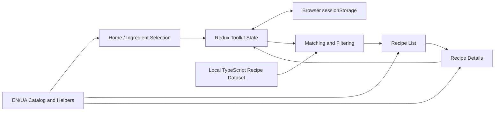

# Recipe Generator - Application Architecture

## Overview

The application is a client-side React and TypeScript vertical slice. Recipe content is embedded in the frontend TypeScript dataset; Redux Toolkit owns shared selection and navigation state; matching is deterministic and local. There is no runtime recipe API, backend database, or account system.

## Technology and code areas

| Area | Responsibility | Location |
|------|----------------|----------|
| Application shell | Initialize React/Redux and render the active page | `frontend/src/main.tsx`, `frontend/src/App.tsx` |
| Pages | Render ingredient selection, recipe results, and recipe details | `frontend/src/features/recipe-generator/` |
| Shared state | Store selected ingredients, filters, active page, selected recipe id, and language | `frontend/src/store/` |
| Session persistence | Hydrate and persist app state for the current browser session | `frontend/src/App.tsx` using `sessionStorage` |
| Recipe data | Store typed recipe records and the canonical selectable ingredient catalog | `frontend/src/data/recipes.ts` |
| Matching | Normalize names, calculate partial matches, apply filters, and rank results | `frontend/src/lib/recipeMatching.ts` |
| Localization and categories | Provide EN/UA ingredient labels, category headings, UI text, and category lookup | `frontend/src/lib/i18n.ts` |
| Shared types | Define recipe, ingredient, filter, match, and category contracts | `frontend/src/types/recipe.ts` |
| Shared UI primitives | Provide reusable cards, buttons, inputs, and labels | `frontend/src/components/ui/` |

## Ingredient selector

The Home page assembles selectable options from recipe ingredients, the canonical dataset catalog, and seasonings. Every option must resolve to a bilingual label and exactly one category.

| Category id | English heading | Ukrainian heading |
|-------------|-----------------|-------------------|
| `meat` | Meat & Poultry | М'ясо та птиця |
| `grains` | Grains & Cereals | Крупи та зернові |
| `vegetables` | Vegetables & Greens | Овочі та зелень |
| `dairy` | Dairy & Cheese | Молочні продукти |
| `bakery` | Bakery & Bread | Хлібобулочні вироби |
| `spices` | Spices & Seasonings | Спеції та приправи |
| `pantry` | Pantry & Oils | Бакалія та соуси |

The category union is `IngredientCategory`; category headings and name-to-category assignments are maintained alongside the bilingual catalog in `frontend/src/lib/i18n.ts`.

## Data flow

1. The user selects ingredients and filters on Home; the typed Redux slice stores them.
2. `frontend/src/App.tsx` hydrates and persists the relevant state through `sessionStorage`.
3. The matching helper reads the local recipe records and current selection/filters.
4. The Recipe List displays ranked partial matches, available ingredients, and missing ingredients.
5. Recipe Details reads the selected recipe and current language from shared state.

## Matching and filtering rules

1. Normalize selected and required ingredient names before comparison.
2. Calculate relevance from matched required ingredients divided by scored required ingredients, not by the number of user-selected ingredients.
3. Salt, black pepper, and sugar are baseline seasonings: they do not lower the match percentage or appear as required missing items when not selected.
4. Exclude zero-match recipes and preserve useful partial matches.
5. Identify available and missing ingredients for display.
6. Apply vegetarian, vegan, gluten-free, and maximum preparation-time filters.
7. Sort by match percentage descending, then by missing ingredient count ascending, then recipe name for deterministic ties.
8. Do not mutate source recipe or selection data.

## State and persistence

Redux Toolkit is the single source of truth for selected ingredients, dietary and preparation-time filters, current page, selected recipe id, and language. `frontend/src/App.tsx` stores these fields under `recipe-generator-state` in browser `sessionStorage` and hydrates them on application startup. This is session-scoped browser persistence; it is not `localStorage` or server-side persistence. Clearing the selection resets ingredients, filters, recipe context, and page state.

## Dataset contract

Recipe records implement `Recipe` in `frontend/src/types/recipe.ts` and are stored in `frontend/src/data/recipes.ts`. The contract includes:

- `id`, English `name` and `description`, and corresponding `uk` content
- `image`, `prepTimeMinutes`, `difficulty`, `servings`, and `dietaryTags`
- English and Ukrainian ingredient names with quantities
- Ordered English and Ukrainian preparation steps

The ingredient selector's canonical names live in the same local data module. Their translations, normalized localization keys, and category mappings live in `frontend/src/lib/i18n.ts`. The data is static and does not require network access to load.

## Media resilience

Recipe images use the shared `getRecipeImage` resolver from the local dataset module. Rendered recipe list and detail images provide localized alt text and an `onError` fallback to the default food image. Preserve both resolver behavior and render-site fallback handling when changing image code.

## Error and empty states

- No ingredients selected: explain that at least one predefined ingredient is required.
- No matching recipes: explain that filters or selected ingredients can be adjusted.
- Missing recipe id: show a not-found state with a return action.
- Invalid persisted state: discard invalid session data and continue with safe initial state.
- Remote image failure: replace the failed image with the configured fallback.
